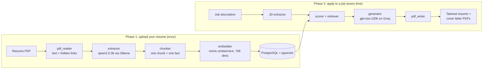

# TruthCV

**Tailor your resume to any job description, without inventing a single fact.**

TruthCV takes your resume (PDF) and a job description, then produces a tailored resume, a cover letter, and answers to application questions. Everything it writes comes from your real resume.

---

## The problem

Most people send the same resume to every job, but recruiters look for the specific skills named in the job description. The usual fixes both have a cost:

- **Rewriting by hand** for every application is slow.
- **Generic AI resume tools** send your whole resume to a chatbot, which tends to invent experience that a recruiter later catches.

TruthCV rewrites your resume for each job, but the AI only works from facts it retrieved from *your* resume, and code (not the AI) controls the facts that must stay exact.

## Features

- Upload a resume PDF and extract it into structured data, including **links hidden behind icons**
- Paste a job description and get a **match report**: matched, partial and missing skills, with a match percentage
- Get a **tailored resume** (PDF), with the most relevant projects and skills first
- Get a **cover letter** (PDF) written from real evidence in your resume
- **Ask application questions** such as "Why should we hire you?" and get answers grounded in your resume
- Honest handling of weak matches: low-match applications get a short, non-hyped letter instead of fake enthusiasm

## How it works



The full component diagram is in [`architecture.png`](docs/architecture.png).

### Phase 1: upload your resume (once)

1. **Read** the PDF text and any hyperlinks hidden behind icons.
2. **Extract** the text into structured JSON (name, skills, projects, education...) with a local LLM.
3. **Chunk** the JSON into small facts: one skill or one bullet per chunk.
4. **Embed** each fact into a 768-number vector.
5. **Store** the facts and vectors in PostgreSQL with pgvector.

Your resume is now searchable by meaning.

### Phase 2: apply to a job (every time)

1. **Extract** the job description into JSON (required skills, responsibilities, qualifications).
2. **Score** the match by comparing the JD skills against your stored facts (matched / partial / missing).
3. **Select** the projects most relevant to the JD.
4. **Generate** the tailored resume and cover letter with a hosted LLM, using only the selected facts.
5. **Render** both as A4 PDFs from HTML templates.

### The core idea: retrieval-augmented generation (RAG)

A typical AI resume tool says: *"Here is my resume and the JD, write me a new resume."* The model sees everything and fills the gaps with inventions.

TruthCV says: *"Here are only the facts that match this JD. Write using only these."* A model that never sees what you don't have has much less room to invent it.

## How TruthCV keeps the output honest

- **Retrieval:** only the parts of your resume that relate to the job reach the writing model.
- **Scoring:** the match report is computed from stored evidence, not from the model's opinion.
- **Code owns the facts:** contact details, links, education and project tech lists are copied from your stored resume after generation. The model only supplies wording.
- **Validation:** empty or malformed model output is rejected and retried, and any project the model invents is dropped.
- **Honest stretch mode:** a low match produces a short, plain letter that does not claim skills you lack.

## Tech stack

| Layer | Technology |
|---|---|
| Backend | FastAPI, SQLAlchemy |
| Database | PostgreSQL with pgvector |
| PDF reading | PyMuPDF |
| PDF writing | Jinja2 + WeasyPrint (HTML to A4 PDF) |
| Frontend | Single-page dashboard (`app.js`) |

| Task | Model | Runs on |
|---|---|---|
| Extract facts from resume and JD | `qwen2.5:3b` | Your machine (Ollama) |
| Turn facts into vectors | `nomic-embed-text` | Your machine (Ollama) |
| Write tailored resume, cover letter, answers | `openai/gpt-oss-120b` | Groq cloud API |

Only the writing step uses the cloud. Extraction and embeddings stay on your machine.

## Getting started

### Prerequisites

- Python 3.10+
- [PostgreSQL](https://www.postgresql.org/) with the [pgvector](https://github.com/pgvector/pgvector) extension
- [Ollama](https://ollama.com/)
- A [Groq API key](https://console.groq.com/)
- WeasyPrint's system libraries (Pango). On Windows, install the GTK runtime, see the [WeasyPrint install guide](https://doc.courtbouillon.org/weasyprint/stable/first_steps.html).

### 1. Clone and install

```bash
git clone https://github.com/<your-username>/truthcv.git
cd truthcv

python -m venv .venv
# Windows:  .venv\Scripts\activate
# macOS/Linux:  source .venv/bin/activate

pip install -r requirements.txt
```

### 2. Pull the local models

```bash
ollama pull qwen2.5:3b
ollama pull nomic-embed-text
```

### 3. Set up the database

```sql
CREATE DATABASE truthcv;
\c truthcv
CREATE EXTENSION IF NOT EXISTS vector;
```

Tables are created automatically on startup.

### 4. Configure environment

Create a `.env` file in the project root:

```env
GROQ_API_KEY=your_groq_api_key
GENERATION_MODEL=openai/gpt-oss-120b
GENERATION_TIMEOUT=180
```

Database and Ollama settings live in `config.py`.

> **Groq free plan:** it has per-minute and daily token caps. While developing, point `GENERATION_MODEL` at a smaller model so you don't burn the daily limit.

### 5. Run

```bash
uvicorn app.main:app --reload
```

Open the dashboard in your browser, upload your resume, paste a job description, and generate.

## Testing without the UI

```bash 
python -m scripts.test_pipeline resume.pdf
python -m scripts.test_pdf
```

## Limitations

- Single-user mode: there are no user accounts yet.
- Scanned PDFs are not supported (they need OCR).
- Resumes must be uploaded; TruthCV does not create one from scratch.
- It does not apply to jobs for you.
- Rewritten project bullets are guided by the prompt but not yet checked line by line against the source.
- Small local models (3B) can misread unusual resume layouts. Check the extracted data before generating.

## License

This project is licensed under the **GNU General Public License v3.0**.

You are free to use, modify, and distribute this software, provided that
any derivative work is also released under the GPL v3.0. See the
[LICENSE](LICENSE) file for the full text.